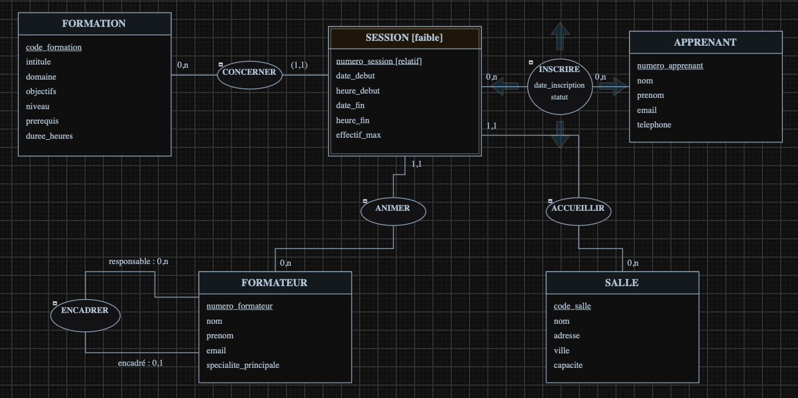

# Projet_Loua-_Mustapha

## 1. Présentation du projet

FormaPlus est un organisme fictif de formation professionnelle continue en informatique. Il propose aux adultes des formations courtes en programmation, bases de données et bureautique, organisées en présentiel.

Ce projet vise à concevoir sa base de données en suivant la méthode MERISE. Cette première partie porte sur l’analyse des besoins et la réalisation du modèle conceptuel de données (MCD).

Le périmètre comprend :
- le catalogue des formations ;
- les sessions de formation ;
- les formateurs et leur encadrement ;
- les apprenants et leurs inscriptions ;
- les salles de formation.

La paie, la comptabilité et le financement des formations sont exclus du périmètre.

## 2. Membres du groupe

- Louaï Arichi
- Mustapha 

## 3. Référence utilisée

Site de référence : [Catalogue des formations Cegos](https://www.cegos.fr/formations).

Cegos sert de référence pour comprendre le secteur de la formation professionnelle. FormaPlus est un organisme fictif : les règles internes utilisées dans ce projet sont des hypothèses pédagogiques et ne décrivent pas le fonctionnement réel de Cegos.

## 4. Prompt final utilisé

Tu travailles dans le domaine de la formation professionnelle continue en informatique. Ton organisme de formation, nommé FormaPlus, a comme activité de proposer aux adultes des formations courtes en programmation, bases de données et bureautique, organisées en sessions en présentiel. C’est un organisme fictif inspiré d’un acteur réel comme Cegos. Les données collectées concernent le catalogue des formations, les sessions programmées, les formateurs et leur encadrement, les apprenants, leurs inscriptions et les salles de formation. Inspire-toi du site web suivant : https://www.cegos.fr/formations. Cette référence sert à comprendre le secteur d’activité ; les règles internes ci-dessous sont des hypothèses pédagogiques propres à FormaPlus et ne doivent pas être présentées comme les règles réelles de Cegos.

Pour délimiter le fonctionnement de FormaPlus : chaque session concerne une seule formation et porte un numéro unique uniquement à l’intérieur de cette formation ; le même numéro peut donc être réutilisé pour une autre formation. Une session ne peut pas exister sans la formation à laquelle elle se rattache. Chaque session est animée par un seul formateur et se déroule dans une seule salle ; un formateur et une salle peuvent être associés à plusieurs sessions à des dates différentes, sans chevauchement. Certains formateurs encadrent d’autres formateurs : un formateur a au plus un responsable, lui-même formateur, et peut encadrer plusieurs collègues. Aucun formateur ne peut se superviser lui-même, directement ou indirectement. Un apprenant peut s’inscrire à plusieurs sessions et une session peut accueillir plusieurs apprenants ; chaque inscription concerne un seul apprenant et une seule session et possède une date et un statut. Une même personne ne peut pas s’inscrire deux fois à la même session. Le nombre d’inscriptions confirmées ne doit dépasser ni l’effectif maximal de la session ni la capacité de la salle. Une session a une date et une heure de début et de fin, et sa fin est postérieure à son début. Limite le périmètre à ces activités, sans intégrer la paie, la comptabilité ou le financement des formations.

Ton organisme de formation veut appliquer MERISE pour concevoir un système d'information. Tu es chargé de la partie analyse, c’est-à-dire de collecter les besoins auprès de l’entreprise. Elle a fait appel à un étudiant en ingénierie informatique pour réaliser ce projet, tu dois lui fournir les informations nécessaires pour qu’il applique ensuite lui-même les étapes suivantes de conception et développement de la base de données.

D’abord, établis les règles de gestions des données de ton organisme de formation, sous la forme d'une liste à puce. Elle doit correspondre aux informations que fournit quelqu’un qui connaît le fonctionnement de l’entreprise, mais pas comment se construit un système d’information.

Ensuite, à partir de ces règles, fournis un dictionnaire de données brutes avec les colonnes suivantes, regroupées dans un tableau : signification de la donnée, type, taille en nombre de caractères ou de chiffres. Il doit y avoir entre 25 et 35 données. Il sert à fournir des informations supplémentaires sur chaque donnée (taille et type) mais sans a priori sur comment les données vont être modélisées ensuite.

Fournis donc les règles de gestion et le dictionnaire de données.

## 5. Règles de gestion obtenues

Les règles suivantes ont été générées avec ChatGPT à partir du prompt ci-dessus. Elles décrivent le fonctionnement fictif de FormaPlus.

### 5.1. Catalogue des formations

- **RG01** — FormaPlus propose des formations courtes en présentiel dans trois domaines : programmation, bases de données et bureautique.
- **RG02** — Chaque formation possède un code unique, un intitulé, un domaine, des objectifs pédagogiques, un niveau, des prérequis et une durée pédagogique exprimée en heures entières.
- **RG03** — Le niveau d’une formation est « débutant », « intermédiaire » ou « avancé ». Lorsqu’aucun prérequis n’est nécessaire, la mention « Aucun » est enregistrée.
- **RG04** — Une formation peut être inscrite au catalogue sans qu’une session soit encore programmée. Elle peut ensuite donner lieu à plusieurs sessions.

### 5.2. Sessions de formation

- **RG05** — Chaque session concerne une seule formation et ne peut pas exister sans celle-ci.
- **RG06** — Chaque session porte un numéro unique à l’intérieur de sa formation. Deux formations différentes peuvent donc avoir chacune une session numéro 1. Pour désigner une session sans ambiguïté, on utilise le code de sa formation et son numéro.
- **RG07** — Une session possède une date et une heure de début, une date et une heure de fin ainsi qu’un effectif maximal strictement positif. Sa fin doit être postérieure à son début.

### 5.3. Formateurs et encadrement

- **RG08** — Chaque session est animée par un seul formateur. Un formateur peut n’animer aucune session ou en animer plusieurs, à condition que leurs horaires ne se chevauchent pas.
- **RG09** — Chaque formateur possède un numéro interne unique, un nom, un prénom, une adresse électronique et une spécialité principale.
- **RG10** — Un formateur peut avoir au maximum un responsable, qui est lui-même un formateur de FormaPlus. Un formateur peut encadrer plusieurs collègues ou n’en encadrer aucun.
- **RG11** — Un formateur ne peut pas être son propre responsable. Les boucles d’encadrement sont également interdites : si un formateur encadre un collègue, ce dernier ne peut pas devenir son supérieur, directement ou par une chaîne de responsables.

### 5.4. Salles de formation

- **RG12** — Chaque session se déroule dans une seule salle. Une salle peut accueillir plusieurs sessions, à condition que leurs horaires ne se chevauchent pas. Elle peut aussi n’accueillir aucune session.
- **RG13** — Chaque salle possède un code unique, un nom, une adresse, une ville et une capacité d’accueil strictement positive.

### 5.5. Apprenants et inscriptions

- **RG14** — Chaque apprenant possède un numéro interne unique, un nom, un prénom, une adresse électronique et un numéro de téléphone.
- **RG15** — Un apprenant peut être enregistré avant toute inscription. Il peut ensuite s’inscrire à plusieurs sessions. Une session peut recevoir plusieurs inscriptions ou n’en avoir aucune.
- **RG16** — Chaque inscription concerne un seul apprenant et une seule session. Un même apprenant ne peut avoir qu’une inscription à une session donnée.
- **RG17** — Chaque inscription possède une date et un statut : « en attente », « confirmée » ou « annulée ». En cas d’annulation, l’inscription est conservée et son statut est modifié.
- **RG18** — Pour chaque session, le nombre d’inscriptions confirmées ne doit dépasser ni l’effectif maximal prévu ni la capacité de la salle. Les inscriptions en attente et annulées ne sont pas comptées dans cet effectif.

### 5.6. Limites du périmètre

- **RG19** — La gestion de la paie, de la comptabilité et du financement des formations est exclue du périmètre.

## 6. Dictionnaire des données brutes obtenu

Le dictionnaire généré contient **30 données**.

Les tailles correspondent à des longueurs maximales, sauf pour les dates et les heures dont le format est fixe. Les numéros de téléphone sont du texte afin de conserver les zéros initiaux et le signe `+`.

Les dates et heures sont présentées sous un format lisible ; leur stockage technique sera défini ultérieurement.

| Signification de la donnée | Type | Taille en nombre de caractères ou de chiffres |
|---|---|---|
| Code unique d’une formation | Alphanumérique | 10 caractères maximum |
| Intitulé d’une formation | Texte | 100 caractères maximum |
| Domaine d’une formation | Texte | 30 caractères maximum |
| Objectifs pédagogiques d’une formation | Texte | 500 caractères maximum |
| Niveau d’une formation | Texte | 15 caractères maximum |
| Prérequis d’une formation | Texte | 300 caractères maximum |
| Durée pédagogique d’une formation, en heures | Entier positif | 3 chiffres maximum |
| Numéro d’une session au sein de sa formation | Entier positif | 4 chiffres maximum |
| Date de début d’une session | Date | 10 caractères au format `AAAA-MM-JJ` |
| Heure de début d’une session | Heure | 5 caractères au format `HH:MM` |
| Date de fin d’une session | Date | 10 caractères au format `AAAA-MM-JJ` |
| Heure de fin d’une session | Heure | 5 caractères au format `HH:MM` |
| Effectif maximal d’une session | Entier positif | 3 chiffres maximum |
| Numéro interne unique d’un formateur | Entier positif | 6 chiffres maximum |
| Nom d’un formateur | Texte | 50 caractères maximum |
| Prénom d’un formateur | Texte | 50 caractères maximum |
| Adresse électronique d’un formateur | Texte | 254 caractères maximum |
| Spécialité principale d’un formateur | Texte | 100 caractères maximum |
| Numéro interne unique d’un apprenant | Entier positif | 8 chiffres maximum |
| Nom d’un apprenant | Texte | 50 caractères maximum |
| Prénom d’un apprenant | Texte | 50 caractères maximum |
| Adresse électronique d’un apprenant | Texte | 254 caractères maximum |
| Numéro de téléphone d’un apprenant | Texte | 20 caractères maximum |
| Code unique d’une salle | Alphanumérique | 10 caractères maximum |
| Nom d’une salle | Texte | 50 caractères maximum |
| Adresse d’une salle, hors ville | Texte | 150 caractères maximum |
| Ville dans laquelle se situe une salle | Texte | 100 caractères maximum |
| Capacité d’accueil d’une salle, en personnes | Entier positif | 3 chiffres maximum |
| Date d’une inscription | Date | 10 caractères au format `AAAA-MM-JJ` |
| Statut d’une inscription | Texte | 10 caractères maximum |

## 7. Modèle conceptuel de données

[Fichier source modifiable](MCD_FormaPlus.drawio)
Le MCD a été réalisé avec diagrams.net (draw.io), en raison de difficultés d’utilisation de Looping sous Mac . Le schéma et son fichier source modifiable sont disponibles dans ce dépôt . 

## 8. Vérifications et corrections

Cette section sera complétée après la vérification des résultats et du MCD 
